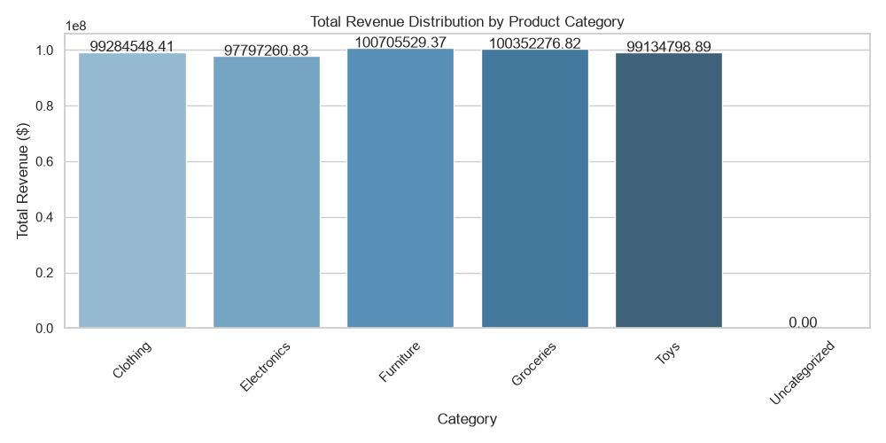

# Retail Inventory Analytics

A Python analytics pipeline for cleaning retail inventory data, evaluating product demand and stock levels, comparing existing demand forecasts with observed sales, and exporting visual summaries.

## Project Overview

This project processes a retail inventory workbook covering 2025–2026. It separates data preparation from analysis so that the input can be cleaned and standardized before business metrics and charts are generated.

The end-to-end workflow is:

1. Read the source Excel workbook.
2. Remove duplicate records and clean selected date, category, price, inventory, sales, and discount values.
3. Save the cleaned records as a CSV file.
4. Calculate revenue, demand, inventory-risk indicators, and forecast error.
5. Export six charts to the `outputs/` directory.

## Analytical Questions

The pipeline is designed to help explore:

- How much revenue and sales volume are represented in the dataset?
- Which product IDs have the highest and lowest recorded demand?
- Which categories contribute the most revenue and units sold?
- How does daily sales volume change over time?
- How closely do the provided demand forecasts match observed units sold?
- Which products meet the project's under-stock or over-stock heuristics?
- How are units sold distributed across seasonality labels?

## Data and Assumptions

### Input

The full pipeline expects this workbook at the project-relative path:

```text
data/rawdata/retail_store_inventory_extended_messy_2025_2026.xlsx
```

The analysis uses fields including `Date`, `Product ID`, `Category`, `Seasonality`, `Units Sold`, `Price`, `Discount`, `Inventory Level`, and `Demand Forecast`.

### Cleaning rules

Implemented in `src/data_cleaning.py`:

| Data quality issue | Current handling |
| --- | --- |
| Duplicate records | Exact duplicate rows are removed. |
| Category, region, weather, and seasonality labels | Leading/trailing whitespace is removed and text is title-cased; string values representing missing data are converted to nulls. |
| Invalid dates | Dates are parsed with coercion; rows with unparseable dates are dropped. |
| Negative inventory and units sold | Values are treated as missing and filled using the respective dataset-wide median. |
| Discounts outside 0–100 | Values are treated as missing. |
| Prices above $1,000 | Values are treated as missing and filled using the median price for the corresponding category. |
| Missing categories | Filled with `Uncategorized`. |

These are project-specific rules, not universal retail accounting or inventory policies. In particular, the script does not currently impute every missing field in the workbook.

### Metric definitions

- **Total revenue:** `Units Sold × Price × (1 − Discount / 100)`, summed across rows. This uses the dataset's discount percentage; it does not account for taxes, returns, shipping, or other adjustments.
- **Average unit price:** Mean of the row-level `Price` values; this is not weighted by units sold.
- **Product average daily demand:** Mean of that product's `Units Sold` values across its available rows.
- **Stock status:** Uses the mean recorded inventory per product as a proxy. A product is marked under-stocked below three times its average daily demand, over-stocked above fifteen times its average daily demand, and otherwise optimal.
- **Forecast MAE:** Mean absolute difference between the provided `Demand Forecast` and `Units Sold` for rows with both values available. The project evaluates the supplied forecasts; it does not train a forecasting model.

## Analysis and Outputs

The analysis stage prints the financial summary, top and bottom demand products, stock-status counts, and forecast mean absolute error (MAE).

Six charts are saved under `outputs/`:

| File | Contents |
| --- | --- |
| `01_category_revenue.png` | Revenue by product category |
| `02_seasonal_units_distribution.png` | Share of units sold by seasonality |
| `03_top_demand_products.png` | Ten products with the highest total demand |
| `04_demand_trend_7day_moving_avg.png` | Daily sales and a seven-day moving average |
| `05_forecast_vs_actual.png` | Provided demand forecast compared with observed units sold |
| `06_high_demand_categories.png` | Units sold by product category |

### Example: Revenue by Category



The pipeline also writes the cleaned dataset to:

```text
data/cleandata/retail_store_inventory_cleaned.csv
```

## Repository Structure

```text
Retail_inventory_analytics/
├── data/
│   ├── rawdata/
│   │   └── retail_store_inventory_extended_messy_2025_2026.xlsx
│   └── cleandata/
│       └── retail_store_inventory_cleaned.csv
├── outputs/
│   ├── 01_category_revenue.png
│   ├── 02_seasonal_units_distribution.png
│   ├── 03_top_demand_products.png
│   ├── 04_demand_trend_7day_moving_avg.png
│   ├── 05_forecast_vs_actual.png
│   └── 06_high_demand_categories.png
├── src/
│   ├── analysis.py
│   └── data_cleaning.py
├── main.py
├── requirements.txt
└── README.md
```

## Requirements

- Python 3
- Packages listed in `requirements.txt`
- The source workbook at the input path described above

Install the dependencies from the project root:

```bash
python -m pip install -r requirements.txt
```

If you have multiple Python installations, use the interpreter that will run the pipeline for both installation and execution. For example, in PowerShell:

```powershell
D:\python.exe -m pip install -r requirements.txt
```

## Run the Full Pipeline

From the project root:

```bash
python main.py
```

The entry point cleans the workbook, writes the cleaned CSV, runs the analysis, and saves the charts. Existing output files with the same names are overwritten.

To run data cleaning or analysis separately, use:

```bash
python -m src.data_cleaning
python -m src.analysis
```

The standalone analysis script looks for a cleaned CSV in `outputs/retail_store_inventory_cleaned.csv`, then `data/cleaned_retail_inventory_2025_2026.csv`; if neither exists, it tries the workbook at the project root. For the standard project input and output paths, `python main.py` is the recommended command.

## Reproducibility and Limitations

- Summary values depend on the input workbook and the cleaning rules above; they are not fixed project constants.
- Median imputation can affect downstream totals and should be considered when interpreting results.
- The stock-status multipliers are simple analytical heuristics and should be calibrated against lead times, service levels, and replenishment policies before operational use.
- Forecast MAE is an aggregate error measure and does not by itself indicate forecast bias or performance by product, store, or season.
- This repository is an analytical example, not a production inventory-control system. Validate business definitions and source data before using results for purchasing or financial decisions.

## Simple Dashboard

A basic Streamlit dashboard is available in `dashboard.py`. It displays the existing summary metrics and stock-status rules, charts for daily demand and its 7-day moving average, revenue by category, top-demand products, actual versus forecast demand, units sold by seasonality, units sold by category, and forecast comparisons. It also includes product-demand tables. The charts use the project's cleaned dataset; the existing cleaning and analysis pipeline is unchanged.

Run these commands from the project root:

```bash
python -m pip install -r requirements.txt
python main.py
python -m streamlit run dashboard.py
```
